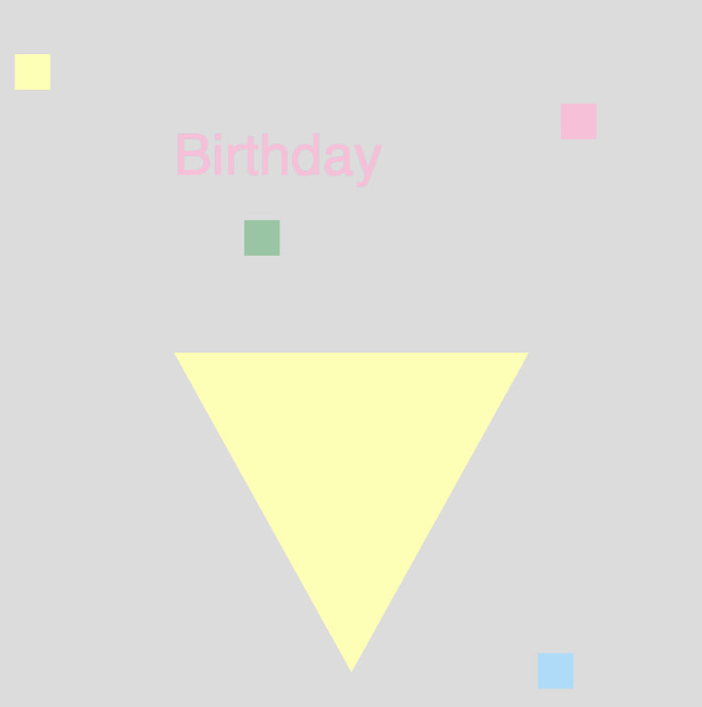
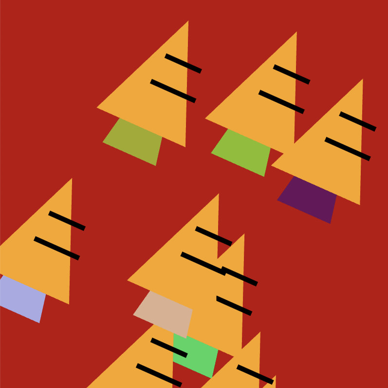

# Week 3 — Arrays, Functions and Transformations

<!-- Replace ## with the week number and Topic Name with the week's focus -->
<!-- You may also refer to each week's slide for the Topic Name -->
<!-- e.g. Week 03 — Arrays & Functions -->

---

### Activities

| Activity | What I Made                   |
| -------- | ----------------------------- |
| `3a`     | <An interactive birthday card> |
| `3b`     | <Carrots with randomised colourful stems turning> |

<!-- Add or remove rows to match the activities for this week. -->

---

### This Week

<I learn how to simplify and speed up the creation of code by using arrays and functions such that I can apply the interaction to more features without manually typing a longer code. I also learnt how to utilise transformation to make my visual more engaging.>

---

### Output





### 🎥 Demo Video
[video 3a] <https://drive.google.com/file/d/1u1lnTNYL-ZJLp2kq_OL6g8Ty9KrGlZYW/view?usp=drive_link>
[video 3b] <https://drive.google.com/file/d/1afunc0639AOUybn4Y9s6F1KNmL84w4TH/view?usp=drive_link>
<!-- Drop a screenshot, photo, or GIF of something you made this week.
     Save it to a readme-assets/ folder inside this week's folder.
     Made more than one thing worth showing? Add more images. -->

---

<!-- ─────────────────────────────────────────────────────
     GOING FURTHER — if you want to document more, here are some ideas:

     ### 1a — Activity Name
     
     What you tried, what you discovered.

     ### 1b — Activity Name
     
     What you tried, what you discovered.

     ### 🧩 Something I Found Interesting
     A line of code, a technique, a happy accident — paste it here.
     ```js
     // your code here
     ```

     ### ❓ Questions I'm Sitting With
     Anything unresolved, something you want to revisit, or a rabbit hole you fell into.

     ### 🔗 References
     Links to anything that helped or inspired you this week.
     ───────────────────────────────────────────────────── -->
