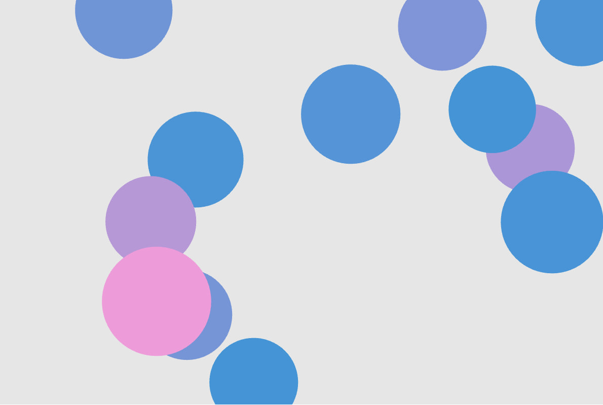

# Week 4 — Object orientated programming (Part 1)

<!-- Replace ## with the week number and Topic Name with the week's focus -->
<!-- You may also refer to each week's slide for the Topic Name -->
<!-- e.g. Week 03 — Arrays & Functions -->

---

### Activities

| Activity | What I Made                   |
| -------- | ----------------------------- |
| `4a`     | <A moving cookie that changes colour> |
| `4b`     | <Bubbles that collides and changes size> |


---

### This Week

<I learn how to use class as a way to code constructor and properties as well as collision to make my visual interactive and engaging.>

---

### Output




### 🎥 Demo Video
[video4a] <https://drive.google.com/file/d/1hePyuOrBMkfpBGp_VY-x7Xa0MI8gjN7j/view?usp=sharing>
[video4b] <https://drive.google.com/file/d/1hLGmRvBrzxA_TS0M4f8xw_WC49eJRUMs/view?usp=drive_link>
<!-- Drop a screenshot, photo, or GIF of something you made this week.
     Save it to a readme-assets/ folder inside this week's folder.
     Made more than one thing worth showing? Add more images. -->

---

<!-- ─────────────────────────────────────────────────────
     GOING FURTHER — if you want to document more, here are some ideas:

     ### 1a — Activity Name
     
     What you tried, what you discovered.

     ### 1b — Activity Name
     
     What you tried, what you discovered.

     ### 🧩 Something I Found Interesting
     A line of code, a technique, a happy accident — paste it here.
     ```js
     // your code here
     ```

     ### ❓ Questions I'm Sitting With
     Anything unresolved, something you want to revisit, or a rabbit hole you fell into.

     ### 🔗 References
     Links to anything that helped or inspired you this week.
     ───────────────────────────────────────────────────── -->
